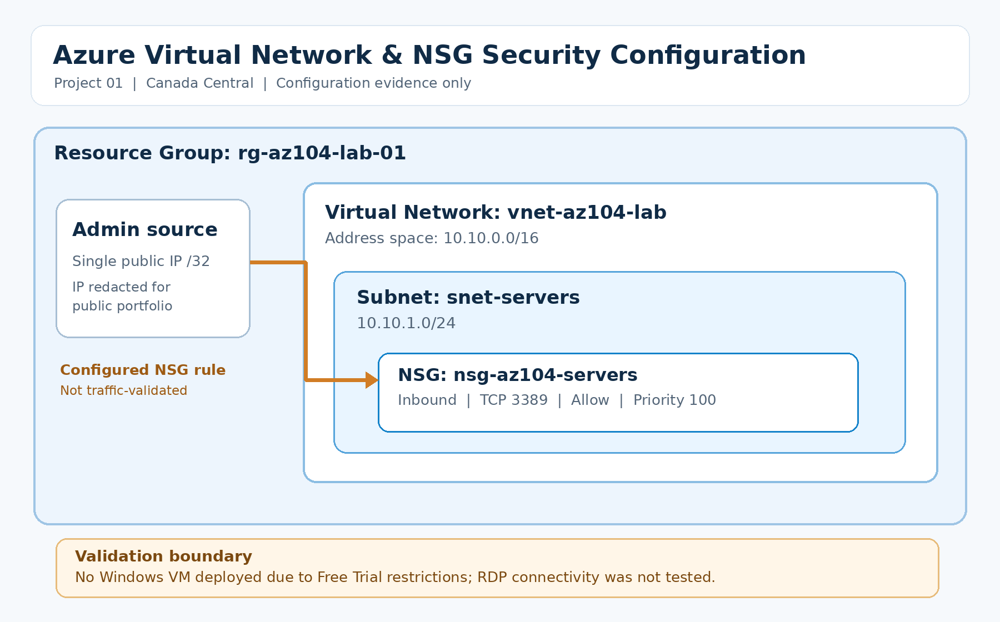
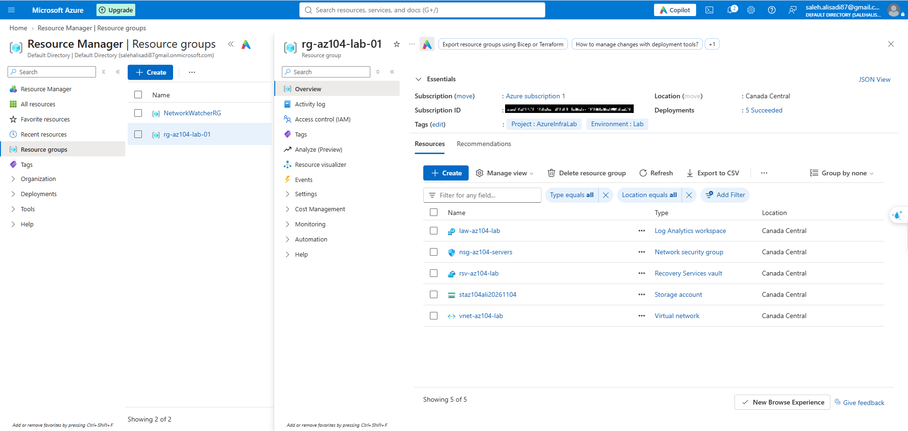
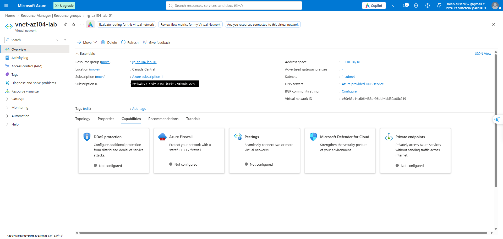
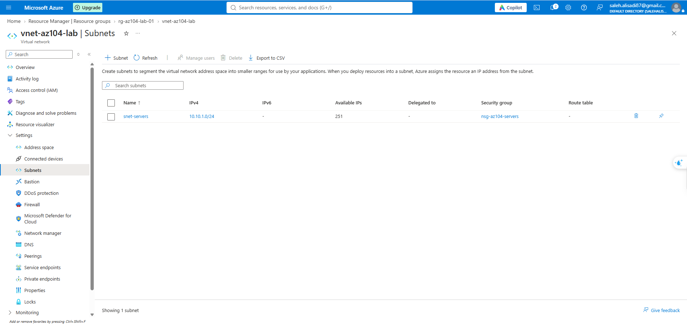
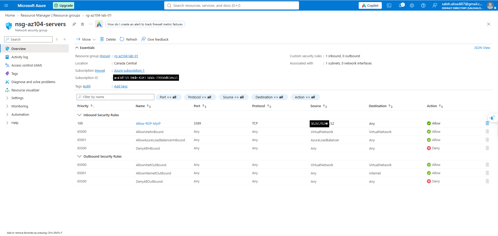

# Azure Virtual Network & NSG Security Configuration

**Azure Networking | Infrastructure Security | Access Control**

## Overview

Designed and configured an Azure Virtual Network with a dedicated server subnet and subnet-level Network Security Group (NSG) controls.

The project demonstrates Azure network configuration, subnet segmentation, inbound access restrictions, and security rule validation through the Azure Portal.

**Region:** Canada Central  
**Resource Group:** `rg-az104-lab-01`

## Business Scenario

An organization needs a structured Azure network environment to support future Windows Server workloads.

The infrastructure must provide:

- A dedicated address space for Azure resources.
- A separate subnet for server workloads.
- Network security controls applied at the subnet level.
- Restricted administrative access using source IP filtering.
- Clear documentation of the configuration and security decisions.

## Architecture

### Network Configuration

| Component | Configuration |
|---|---|
| Resource Group | `rg-az104-lab-01` |
| Region | Canada Central |
| Virtual Network | `vnet-az104-lab` |
| VNet Address Space | `10.10.0.0/16` |
| Server Subnet | `snet-servers` |
| Subnet Address Range | `10.10.1.0/24` |
| Network Security Group | `nsg-az104-servers` |
| NSG Association | Server subnet |
| DNS | Azure-provided DNS |

## Technologies

- Microsoft Azure
- Azure Virtual Network
- Azure Subnets
- Network Security Groups (NSGs)
- TCP/IP Networking
- CIDR Addressing
- Remote Desktop Protocol (RDP)
- Azure Resource Manager

## Implementation

### 1. Resource Organization

Created the resource group `rg-az104-lab-01` in Canada Central to organize infrastructure resources.

Applied resource tags for project identification and environment classification.

### 2. Virtual Network Configuration

Configured `vnet-az104-lab` with the address space `10.10.0.0/16`.

The address space provides capacity for additional subnets and future infrastructure workloads.

### 3. Server Subnet Configuration

Configured the dedicated subnet `snet-servers` using `10.10.1.0/24`.

Associated the Network Security Group `nsg-az104-servers` with the subnet to apply inbound and outbound security rules.

### 4. Network Security Configuration

Configured a custom inbound NSG rule to permit RDP traffic only from a designated public source IP address.

| Setting | Value |
|---|---|
| Rule Name | `Allow-RDP-MyIP` |
| Priority | `100` |
| Direction | Inbound |
| Protocol | TCP |
| Destination Port | 3389 |
| Source | Single public IPv4 address `/32` |
| Destination | Any |
| Action | Allow |

The source IP is omitted from the public documentation.

## Security Considerations

### Source IP Restriction

Restricted the custom RDP inbound rule to a specific public IPv4 address instead of allowing access from all internet sources.

### Subnet-Level Security

Associated the NSG directly with the server subnet, allowing its security rules to apply to traffic associated with resources deployed in that subnet.

### Rule Priority

Configured the custom inbound rule with priority `100`.

Azure NSG rules are evaluated in priority order, with lower numerical values processed first.

### Default NSG Rules

Reviewed the default inbound and outbound security rules, including virtual network traffic allowances and default inbound denial.

Default rules remain relevant and must be considered when evaluating the effective network security posture.

### Production Security

For production environments, administrative access should be evaluated using stronger access patterns, such as Azure Bastion, VPN connectivity, and controlled administrative endpoints.

## Validation & Evidence

The following configuration elements were verified through Azure Portal screenshots:

- Resource group and infrastructure resource inventory.
- Virtual Network address space.
- Server subnet address range.
- NSG association with the server subnet.
- Custom inbound TCP 3389 security rule.
- Source IP restriction using a `/32` prefix.
- Custom rule priority and Allow action.

These checks confirm the saved Azure configuration. They do not constitute live network traffic or RDP connectivity testing.

## Troubleshooting & Operational Checks

When investigating an Azure VM connectivity issue, relevant checks include:

1. Confirming that the VM network interface is connected to the expected subnet.
2. Verifying NSG associations at both subnet and network interface levels.
3. Reviewing inbound security rule priorities, protocols, ports, and source restrictions.
4. Checking the current administrator public IP against the configured source range.
5. Reviewing guest operating system firewall rules and service availability.
6. Using Azure Network Watcher diagnostic capabilities when appropriate.

These are documented operational troubleshooting checks, not claims that each diagnostic procedure was executed in this lab.

## Deployment Limitations

A Windows Server virtual machine was not deployed because of Azure Free Trial subscription restrictions.

Consequently:

- No live Windows Server workload was attached to the subnet.
- No successful RDP connection was tested.
- NSG behavior was validated through saved configuration rather than live traffic testing.
- Azure Network Watcher connectivity diagnostics against a VM were not performed.

## Lessons Learned

This project reinforced the importance of:

- Planning address spaces and subnet boundaries.
- Applying network security controls at the appropriate scope.
- Restricting administrative access by source IP.
- Understanding NSG priorities and default security rules.
- Distinguishing configuration verification from end-to-end connectivity validation.
- Documenting infrastructure decisions and technical limitations clearly.

## Project Evidence

All Azure Portal configuration screenshots are available in the [`screenshots`](screenshots/) directory.

The architecture diagram is available in the [`diagrams`](diagrams/) directory.

---

**Author:** Saleh Ali Sadi  
**Certification:** Microsoft Certified — Microsoft 365 Fundamentals (MS-900)
